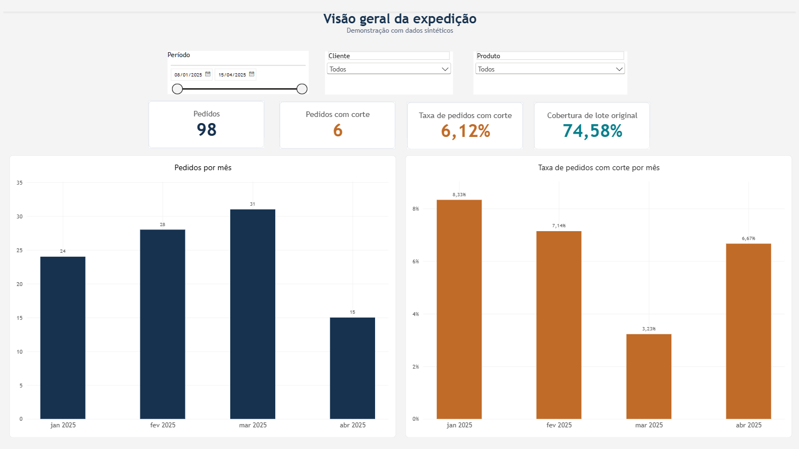
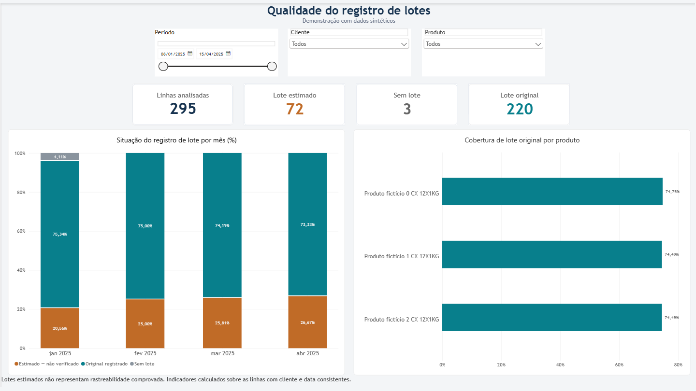
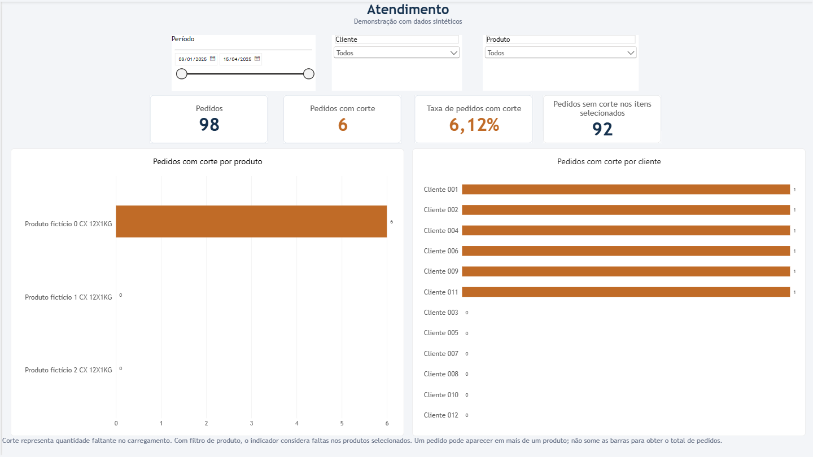

# Inteligência de expedição e rastreabilidade

Análise de registros manuais de carregamento para acompanhamento de pedidos com falta e qualidade do registro de lotes. O projeto reúne tratamento auditável em Python, consultas SQL e um dashboard Power BI com três páginas.

**Python · Pandas · SQL/SQLite · Power BI · DAX · Qualidade de dados**

## Problema de negócio

O diário de carregamento e o estoque eram atualizados manualmente, sem integração com um sistema. Datas conflitantes por pedido, lotes ausentes e quantidades ambíguas dificultavam a consolidação de indicadores confiáveis.

O trabalho organiza os registros, preserva os valores de origem e documenta as decisões de tratamento. A análise identifica pedidos com falta no carregamento e distingue lotes originalmente registrados, estimados e ausentes.

## Estudo real e demonstração pública

O estudo utiliza registros reais de uma operação logística, cujas planilhas não são publicadas. O repositório disponibiliza resultados reais agregados e uma demonstração executável com dados inteiramente sintéticos. O gerador não lê as fontes empresariais.

**As imagens e o PBIX apresentam a demonstração sintética. Seus números são diferentes dos resultados do estudo real.**

## Dashboard Power BI

[Baixar o relatório PBIX](powerbi/inteligencia_expedicao_demo.pbix) · [Instruções de abertura, atualização e modelo](powerbi/ROTEIRO.md) · [Medidas DAX](powerbi/medidas.dax)

### Visão geral da expedição

Volume mensal de pedidos, ocorrência de cortes e cobertura de lote original. Na demonstração: 98 pedidos, 6 com corte (6,12%) e cobertura original de 74,58% nas 295 linhas consistentes.



### Qualidade do registro de lotes

Composição mensal dos registros e cobertura original por produto. A demonstração contém 220 linhas com lote original, 72 com lote estimado e 3 sem lote.



### Atendimento

Pedidos com corte por produto e cliente, com filtros de período, cliente e produto. O corte representa a quantidade que faltou carregar. Com filtro de produto, os cartões consideram os itens selecionados.



## Resultados do estudo real de 2025

| Indicador | Resultado |
|---|---:|
| Pedidos com cliente e data consistentes | 1.826 |
| Pedidos com ao menos um corte | 43 (2,35%) |
| Cobertura de lote original nas 6.428 linhas de origem | 73,99% |
| Pedidos separados para conferência | 74 |

Consulte [resultados e denominadores](docs/RESULTADOS_REAIS.md) e [metodologia e limites](docs/METODOLOGIA.md). A cobertura do estudo real nesta tabela usa todas as linhas de origem; a cobertura do dashboard usa apenas a base consistente da demonstração.

Os resultados são descritivos. Lotes estimados não comprovam rastreabilidade; não há impacto financeiro ou melhoria causal medidos.

## Executar a demonstração

Requer Python 3.11 ou superior. Execute na raiz do projeto:

```bash
python -m venv .venv
```

Ative o ambiente no Windows PowerShell:

```powershell
.venv\Scripts\Activate.ps1
```

Ou no macOS/Linux:

```bash
source .venv/bin/activate
```

Instale as dependências e execute:

```bash
python -m pip install -r requirements.txt
python src/executar_demo.py
python tests/validar_demo.py
```

Abra `outputs/demo/analise/relatorio_operacoes.html` no navegador. A execução gera um banco SQLite, controles de qualidade, gráficos e os cinco CSVs do modelo em `outputs/demo/analise/powerbi/`. As saídas ficam fora do Git. Para atualizar o PBIX em outro computador, ajuste os caminhos das fontes conforme o [roteiro](powerbi/ROTEIRO.md).

## Regras analíticas

- Qtde representa quantidade atendida; Corte representa quantidade faltante; Corte vazio equivale a zero.
- Correções preservam os valores originais e são auditadas. Pedidos com conflitos sem resolução segura ficam separados.
- Duplicatas candidatas são mantidas e sinalizadas; lotes estimados recebem identificação de não verificados.
- Contagens distintas de pedidos por produto não são somadas para obter o total de pedidos.
- Quantidades de unidades diferentes não são agregadas; a medida complementar de atendimento em quantidade exige seleção de um produto e valores válidos.

## Organização

| Pasta | Conteúdo |
|---|---|
| `src/` | Geração sintética, tratamento auditável e análise |
| `sql/` | Consultas sobre o banco tratado |
| `docs/` | Metodologia, resultados reais agregados e imagens |
| `powerbi/` | Relatório PBIX, medidas DAX e documentação do modelo |
| `data/` | Política de dados e orientação para fontes privadas |
| `tests/` | Validação das regras de negócio da demonstração |

## Escopo concluído

Tratamento, análise exploratória, demonstração executável e dashboard Power BI com três páginas concluídos. O relatório utiliza filtros por período, cliente e produto e relações unidirecionais entre dimensões e fatos.

A planilha histórica inicial foi analisada separadamente e não integra automaticamente o diário de 2025. O estoque manual sem data de referência confirmada não sustenta indicadores históricos de ruptura, validade atual ou capacidade.

## Autor

[Jorge Fumagalli](https://github.com/JorgeFumagalli) · MBA em Data Science & Analytics — USP/ESALQ, concluído em 2026.
